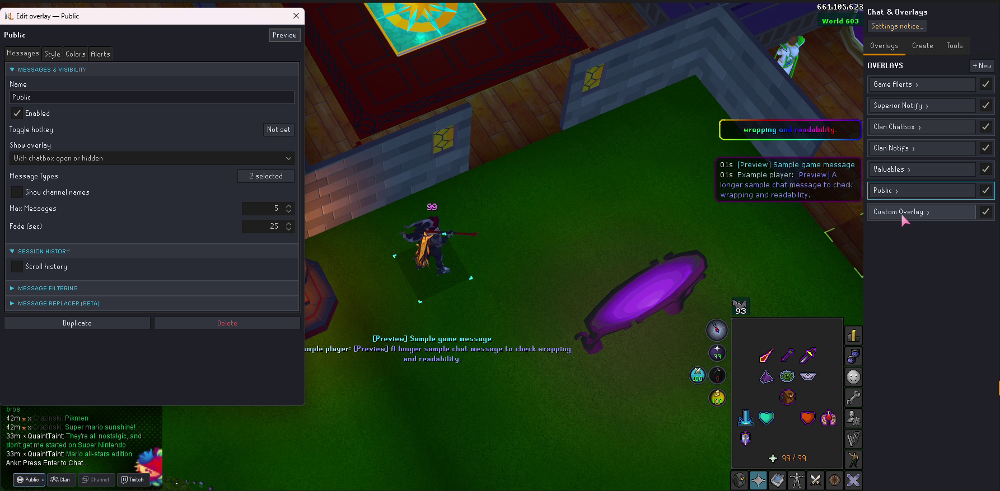
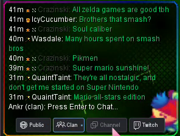
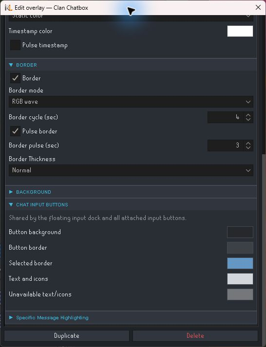
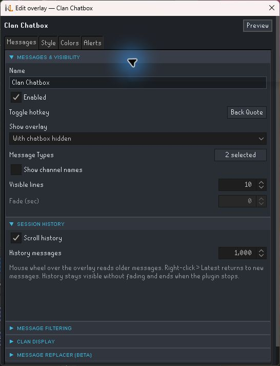

# Improved Chat and Overlays

Give each conversation its own space. Build independent chat overlays with filters, fonts, colors, backgrounds and alerts. Switch where you type with a floating or attached input dock, and resize, collapse or completely hide the native chatbox.

## What you can do

- **Create separate overlays** for your chosen message types, each with its own placement, visibility, style and alerts.
- **Switch your input mode** with selectable Public, Clan, Channel and available GIM buttons.
- **Style text and frames** with static colors, two-color effects, RGB, rounded corners, images or animated GIFs.
- **Read session history** using a scrollable overlay, optional timestamps and duplicate grouping.
- **Filter and highlight messages** with words, sender names and regex rules. Optional overlay replacements leave native chat unchanged.
- **Adjust native chat** with resizing, collapse controls, complete hiding, cleanup and dialogue styling.

## Getting started

1. Install **Improved Chat and Overlays** from RuneLite’s Plugin Hub.
2. Open **Create** in its side panel and choose a preset or custom overlay.
3. Select the overlay under **Overlays**. Choose message types and visibility in **Messages**, then edit **Style**, **Colors** and **Alerts**.
4. Use **Preview** while logged in to try its appearance with sample messages.
5. For chat input buttons, open **Tools → Chat input dock → Show input dock**.

[Watch the 29-second overlay preview](docs/media/multiple-overlay-previews.mp4) for examples of independently styled text, frames and placement using sample messages.

**Recording note:** Twitch controls shown in these recordings are experimental and are not part of the public plugin. GIM chat is supported but not shown.

## Input buttons change where you type

Public, Clan, Channel (Friends Chat) and GIM are input destinations. GIM is offered when a group channel is available. The buttons preserve the visible chat tab and draft; clicking one does not send a message.

[Watch the 17-second input-dock demonstration](docs/media/input-dock-demo.mp4). Public and Clan selections update the input preview; Channel is unavailable in this session.

**Recording note:** Twitch controls shown in these recordings are experimental and are not part of the public plugin. GIM chat is supported but not shown.

Choose which buttons to show and the dock sizes itself to fit. **Button size** scales it from **60–200%**. Alt-drag the floating dock to move it, or drag an edge while holding Alt to resize it. Attach it to an overlay’s **Left side**, **Right side** or **Bottom** to extend that overlay’s background and border around the buttons.

The default active button has a blue outline and the same grey background. Any overlay editor’s **Colors → Chat input buttons** changes the shared background, borders, text and unavailable-mode colors.

Input-button color settings

## Collapse, hide or change opacity

| Choice | Result |
| --- | --- |
| Collapse chat | Replaces the native chatbox with a compact button. |
| Hide entire chatbox hotkey | Hides the native chat area and every static chat button, including All and Report. |
| Chatbox opacity | Changes the appearance of visible chat surfaces. |

Assign **Chatbox → Hide entire chatbox hotkey** in RuneLite’s plugin settings. Press it again to restore chat. Dialogues remain usable. Full hiding resets on logout or profile change; Modern Chat’s visibility controls take precedence.

To remove this plugin’s toolbar icon, use **Overlay setup: side panel → Hide side panel** in RuneLite’s plugin settings. Overlays keep working. Clear that setting from the normal plugin list to restore access to the editor.

## History and media

Enable **Messages → Session History → Scroll history** to browse older lines with the mouse wheel. Scroll to the bottom or use **Latest** to follow new messages again. History survives hops and login/logout while the plugin remains enabled, but ends when the plugin stops or RuneLite closes. It is not a saved chat archive.

Message visibility and session-history settings

PNG, JPEG and animated GIF backgrounds are copied into local plugin storage. Moving the original file does not break the background. Choose the file again when moving the setup to another computer; profile settings alone do not transfer local media.

## Compatibility and support

Settings and overlay positions from the former **Improved Chat** name are retained. Resource-pack backgrounds and RuneLite Chat Color, Chat Filter and Emojis have their own integration controls. **Chat Widgets** and **Force Recolor** are declared conflicts; Modern Chat takes priority for the native features it controls.

See the [full guide](docs/guide.md) for visibility, filtering, animation, file limits, dialogue styling and compatibility. [Report an issue or request a feature](https://github.com/wukuna/improved-chat-and-overlays/issues), including the input mode or overlay affected and other chat plugins in use.

## License and attribution

See [LICENSE](LICENSE) and the [full guide’s attribution](docs/guide.md#license-and-attribution). Existing third-party notices remain part of the project.
